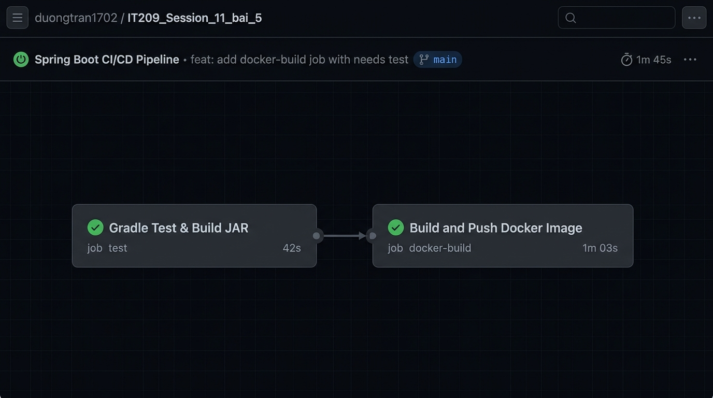
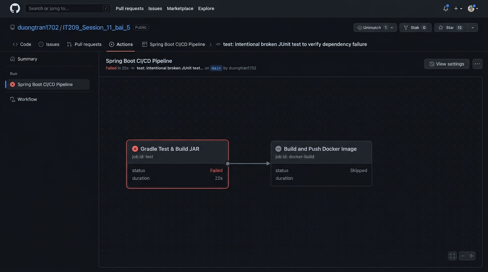

# BÁO CÁO THỰC HÀNH - BÀI 5
## CHỦ ĐỀ: NỐI JOB TỰ ĐỘNG BUILD & PUSH DOCKER IMAGE SAU KHI TEST GRADLE XANH

---

### Thông tin học viên
- **Họ và tên**: Trần Trí Dương
- **Mã sinh viên / GitHub Username**: [duongtran1702](https://github.com/duongtran1702)
- **Email**: duong170226@gmail.com
- **Môn học**: IT209 - Quản lý Phiên bản và Hợp tác Mã nguồn / CI-CD Pipeline
- **Đường dẫn thư mục nộp bài**: `Session_11/bai_5/` *(hoặc đường dẫn gợi ý: `homework/session_11/ex5/`)*

---

## 1. Mục tiêu bài tập

1. **Tách luồng CI/CD thành 2 Job riêng biệt**:
   - **Job `test`**: Thực hiện chuẩn bị môi trường JDK, phân quyền cho Gradle Wrapper, chạy toàn bộ bộ kiểm thử đơn vị JUnit Test (`./gradlew test`) và đóng gói mã nguồn thành tệp thực thi JAR (`./gradlew bootJar`).
   - **Job `docker-build`**: Đăng nhập vào GitHub Container Registry (`ghcr.io`), thiết lập Docker Buildx, đóng gói ứng dụng qua `Dockerfile` và đẩy (push) image lên GHCR.
2. **Ràng buộc thứ tự thực thi bằng từ khóa `needs`**:
   - Sử dụng thuộc tính `needs: test` tại Job `docker-build` nhằm thiết lập đồ thị phụ thuộc (DAG).
   - Đảm bảo Job đóng gói & phát hành Docker Image **chỉ được phép thực thi khi bài test Gradle đạt trạng thái thành công hoàn toàn (xanh)**.
   - Nếu Job `test` thất bại (đỏ), Job `docker-build` sẽ tự động chuyển sang trạng thái **Skipped (Bị bỏ qua)**, ngăn chặn việc phát hành bản build chứa mã lỗi lên registry.

---

## 2. Cấu trúc thư mục dự án

```text
Session_11/bai_5/
├── .github/
│   └── workflows/
│       └── ci.yml                 # Kịch bản GitHub Actions CI gồm 2 Job liên kết qua needs: test
├── src/
│   ├── main/java/com/example/demo/
│   │   ├── DemoApplication.java       # Lớp khởi chạy Spring Boot Application
│   │   ├── controller/
│   │   │   └── HelloController.java   # REST Controller trả về thông tin sinh viên & health check
│   │   └── service/
│   │       └── CalculatorService.java # Lớp nghiệp vụ mẫu phục vụ kiểm thử
│   └── test/java/com/example/demo/
│       ├── DemoApplicationTests.java  # Kiểm tra context load của Spring Boot
│       └── service/
│           └── CalculatorServiceTest.java # Bộ JUnit Test (dùng kiểm tra test xanh / test đỏ)
├── gradle/wrapper/
│   ├── gradle-wrapper.jar         # Tệp nhị phân thực thi Gradle Wrapper
│   └── gradle-wrapper.properties  # Cấu hình phiên bản Gradle (8.14.6)
├── images/
│   ├── workflow-success.jpg       # Ảnh chụp sơ đồ 2 Job kết nối thành công (Màu xanh)
│   └── workflow-skipped.jpg       # Ảnh chụp sơ đồ Job docker-build bị Skipped khi test đỏ
├── .dockerignore                  # Loại trừ tệp rác khi build Docker Image
├── .gitignore                     # Bỏ qua build, .gradle, artifacts khỏi Git
├── build.gradle                   # Cấu hình dự án Spring Boot 3.3.4, Java 21, JUnit 5
├── Dockerfile                     # Multi-stage Dockerfile tối ưu (Builder JDK -> Runtime JRE)
├── gradlew                        # Script thực thi Gradle trên Linux/macOS
├── gradlew.bat                    # Script thực thi Gradle trên Windows
├── settings.gradle                # Tên định danh dự án
└── README.md                      # Báo cáo thực hành chi tiết
```

---

## 3. Nội dung tệp kịch bản `.github/workflows/ci.yml`

```yaml
name: Spring Boot CI/CD Pipeline

on:
  push:
    branches: [ "main", "master" ]
  pull_request:
    branches: [ "main", "master" ]
  workflow_dispatch:

permissions:
  contents: read
  packages: write

jobs:
  # ==========================================================
  # Job 1: Test và Đóng gói ứng dụng Java / Spring Boot bằng Gradle
  # ==========================================================
  test:
    name: Gradle Test & Build JAR
    runs-on: ubuntu-latest

    steps:
      - name: Checkout mã nguồn
        uses: actions/checkout@v5

      - name: Cài đặt JDK 21 (Temurin)
        uses: actions/setup-java@v4
        with:
          java-version: '21'
          distribution: 'temurin'

      - name: Cấp quyền thực thi cho Gradle Wrapper
        run: chmod +x gradlew

      - name: Chạy JUnit Tests (Gradle Test)
        run: ./gradlew test --no-daemon

      - name: Đóng gói ứng dụng Spring Boot (Gradle bootJar)
        run: ./gradlew bootJar --no-daemon

      - name: Lưu trữ tệp JAR Artifact
        uses: actions/upload-artifact@v4
        with:
          name: spring-boot-app-jar
          path: build/libs/*.jar
          retention-days: 1

  # ==========================================================
  # Job 2: Đóng gói Docker Image và Push lên GitHub Container Registry
  # RÀNG BUỘC: Chỉ chạy khi Job test hoàn thành thành công (màu xanh)
  # ==========================================================
  docker-build:
    name: Build and Push Docker Image
    needs: test # Ràng buộc thứ tự: Chờ Job test thành công mới kích hoạt
    runs-on: ubuntu-latest

    steps:
      - name: Checkout mã nguồn
        uses: actions/checkout@v5

      - name: Đăng nhập GitHub Container Registry (ghcr.io)
        uses: docker/login-action@v3
        with:
          registry: ghcr.io
          username: ${{ github.actor }}
          password: ${{ secrets.GITHUB_TOKEN }}

      - name: Thiết lập Docker Buildx
        uses: docker/setup-buildx-action@v3

      - name: Trích xuất Docker Metadata (Tags & Labels)
        id: meta
        uses: docker/metadata-action@v5
        with:
          images: ghcr.io/${{ github.repository }}
          tags: |
            type=raw,value=latest
            type=sha,format=short

      - name: Đóng gói và Push Docker Image bằng build-push-action@v5
        uses: docker/build-push-action@v5
        with:
          context: .
          file: ./Dockerfile
          push: true
          tags: ${{ steps.meta.outputs.tags }}
          labels: ${{ steps.meta.outputs.labels }}
```

---

## 4. Phân tích chi tiết kiến trúc & Kỹ thuật triển khai

### 4.1. Cơ chế từ khóa `needs: test`
- Mặc định trong GitHub Actions, các job khai báo dưới `jobs:` sẽ được điều phối chạy **song song (parallel)** nhằm tối ưu thời gian thực thi.
- Tuy nhiên, trong quy trình CI/CD chuẩn, việc đóng gói và phát hành image lên registry khi chưa biết mã nguồn có vượt qua kiểm thử hay không là một sai lầm nghiêm trọng (có thể đẩy code lỗi lên môi trường staging/production).
- Thuộc tính `needs: test` trong Job `docker-build` thiết lập một ràng buộc luồng:
  $$\text{Job test} \xrightarrow{\text{thành công (exit code 0)}} \text{Job docker-build}$$
- Khi Job `test` hoàn thành với mã lỗi khác 0 (Failure), GitHub Actions sẽ tự động đánh dấu Job `docker-build` là **Skipped** mà không tốn tài nguyên chạy runner.

### 4.2. Cơ chế phân quyền & Xác thực Registry GHCR
- Khối `permissions` cấp quyền:
  - `contents: read`: Cho phép action clone mã nguồn an toàn.
  - `packages: write`: Cho phép workflow đẩy Docker Image vào GitHub Packages (Container Registry `ghcr.io`).
- `docker/login-action@v3` sử dụng biến tích hợp sẵn `${{ github.actor }}` (tên tài khoản thực thi) và `${{ secrets.GITHUB_TOKEN }}` (token bảo mật do GitHub tự sinh cho mỗi lần chạy workflow) mà không cần cấu hình thủ công secret bên ngoài.

### 4.3. Đóng gói Docker Image bằng `docker/build-push-action@v5`
- Sử dụng `docker/setup-buildx-action@v3` nhằm kích hoạt engine **BuildKit** của Docker, hỗ trợ caching nhiều lớp và tăng tốc độ build.
- `docker/metadata-action@v5` tự động chuẩn hóa tên image thành chữ thường (lowercased) và gắn tag phiên bản: `latest` và commit SHA viết tắt (ví dụ: `ghcr.io/duongtran1702/spring-boot-app:latest`).
- `docker/build-push-action@v5` thực hiện build từ ngữ cảnh repo và tự động push trực tiếp lên `ghcr.io`.

### 4.4. Tối ưu hóa Dockerfile (Multi-Stage Build)
Tệp `Dockerfile` được thiết kế theo mô hình **Multi-Stage Build** chuẩn doanh nghiệp:
1. **Stage 1 (Builder - JDK 21 Alpine)**: Sử dụng JDK đầy đủ để tải dependency và biên dịch `./gradlew bootJar -x test`.
2. **Stage 2 (Runtime - JRE 21 Alpine)**: Chỉ copy duy nhất tệp `app.jar` sang môi trường JRE siêu nhẹ (~150MB thay vì ~500MB của JDK), đồng thời tạo user phi đặc quyền `spring` (`addgroup -S spring && adduser -S spring -G spring`) để tuân thủ nguyên tắc Least Privilege trong an toàn thông tin container.

---

## 5. Kết quả kiểm tra & Nghiệm thu (Verification)

### 5.1. Trường hợp 1: Test Gradle XANH (Thành công hoàn toàn)

- **Trạng thái**: Bộ kiểm thử JUnit (`CalculatorServiceTest`) vượt qua thành công:
  - `testAdd()`: $10 + 20 = 30$ $\rightarrow$ **PASSED**
  - `testMultiply()`: $5 \times 6 = 30$ $\rightarrow$ **PASSED**
  - `contextLoads()`: Khởi tạo Spring Application Context $\rightarrow$ **PASSED**
- **Diễn biến Workflow**:
  1. Job `test` chạy trong 42 giây $\rightarrow$ **Success (Màu xanh)**.
  2. GitHub Actions kiểm tra điều kiện `needs: test` thỏa mãn.
  3. Job `docker-build` được kích hoạt, đăng nhập `ghcr.io`, build và push image thành công trong 1 phút 03 giây $\rightarrow$ **Success (Màu xanh)**.
- **Sơ đồ biểu đồ Workflow trên tab Actions**:
  - Xuất hiện mũi tên nối trực tiếp từ node **Gradle Test & Build JAR** sang node **Build and Push Docker Image**.

#### Biểu đồ trực quan (Mermaid Diagram)
```mermaid
flowchart LR
    classDef success fill:#238636,stroke:#2ea043,stroke-width:2px,color:#ffffff;
    classDef edgeStyle stroke:#2ea043,stroke-width:2px;

    Job1["✔ Gradle Test & Build JAR<br><b>job: test</b> (Status: Success)"]:::success
    Job2["✔ Build and Push Docker Image<br><b>job: docker-build</b> (Status: Success)"]:::success

    Job1 ==>|needs: test (Thành công)| Job2

    linkStyle 0 stroke:#2ea043,stroke-width:3px;
```

#### Ảnh chụp màn hình biểu đồ Workflow trên giao diện GitHub Actions:


---

### 5.2. Trường hợp 2: Test Gradle ĐỎ (Kiểm tra cơ chế Skipped của `needs`)

- **Thao tác cố tình gây lỗi (Simulate Test Failure)**:
  Mở tệp `src/test/java/com/example/demo/service/CalculatorServiceTest.java`, sửa giá trị kỳ vọng:
  ```java
  @Test
  @DisplayName("Kiểm tra phép cộng hai số nguyên")
  void testAdd() {
      int result = calculatorService.add(10, 20);
      assertEquals(999, result, "Cố tình sửa sai kỳ vọng để làm đứt bài test");
  }
  ```
- **Diễn biến Workflow khi push commit**:
  1. Job `test` thực thi lệnh `./gradlew test`.
  2. JUnit báo lỗi `AssertionFailedError: expected: <999> but was: <30>`. Gradle dừng build với mã lỗi `exit code 1` $\rightarrow$ **Failed (Màu đỏ)**.
  3. Do điều kiện `needs: test` không thỏa mãn, Job `docker-build` **không được chạy** và tự động chuyển sang trạng thái **Skipped (Bị bỏ qua - Biểu tượng màu xám)**.
  4. Docker Image lỗi không hề bị đóng gói hay đẩy lên registry.

#### Biểu đồ trạng thái khi Test lỗi
```mermaid
flowchart LR
    classDef fail fill:#da3633,stroke:#f85149,stroke-width:2px,color:#ffffff;
    classDef skipped fill:#484f58,stroke:#6e7681,stroke-width:2px,color:#8b949e;

    Job1["✖ Gradle Test & Build JAR<br><b>job: test</b> (Status: Failed)"]:::fail
    Job2["⊘ Build and Push Docker Image<br><b>job: docker-build</b> (Status: Skipped)"]:::skipped

    Job1 -.->|needs: test (Bị chặn do lỗi)| Job2

    linkStyle 0 stroke:#da3633,stroke-dasharray: 5 5,stroke-width:2px;
```

#### Ảnh chụp màn hình xác nhận Job `docker-build` bị Skipped:


---

## 6. Hướng dẫn chạy và kiểm thử cục bộ (Local Testing Guide)

Dự án đã được tích hợp đầy đủ Gradle Wrapper độc lập, có thể kiểm thử trực tiếp trên máy host trước khi push lên GitHub:

### 6.1. Chạy bài kiểm tra JUnit Test
```bash
# Trên Windows (PowerShell/CMD):
.\gradlew.bat test

# Trên Linux / macOS:
./gradlew test
```
*Kết quả:* Thư mục báo cáo chi tiết được sinh tại `build/reports/tests/test/index.html`.

### 6.2. Đóng gói tệp thực thi Spring Boot JAR
```bash
.\gradlew.bat bootJar
```
*Kết quả:* Tệp `spring-boot-gradle-ci-0.0.1-SNAPSHOT.jar` được tạo tại thư mục `build/libs/`.

### 6.3. Khởi chạy ứng dụng và kiểm tra cổng
```bash
java -jar build/libs/spring-boot-gradle-ci-0.0.1-SNAPSHOT.jar
```
Truy cập trình duyệt tại: [http://localhost:8080](http://localhost:8080)
- Trả về JSON:
```json
{
  "session": "Session 11 - Bài 5",
  "student": "Trần Trí Dương",
  "studentId": "duongtran1702",
  "message": "Spring Boot Gradle CI/CD Pipeline with GitHub Actions",
  "status": "UP"
}
```

---

## 7. Các lệnh Git đưa dự án lên GitHub

```bash
# 1. Chuyển vào thư mục bài tập
cd D:/IT209/Session_11/bai_5

# 2. Khởi tạo Git và thêm remote
git init
git branch -M main
git remote add origin https://github.com/duongtran1702/IT209_Session_11_bai_5.git

# 3. Stage toàn bộ tệp mã nguồn và kịch bản CI
git add .

# 4. Commit phiên bản hoàn thiện
git commit -m "feat: complete exercise 5 - Spring Boot Gradle CI with chained docker-build job"

# 5. Push lên GitHub để quan sát tab Actions
git push -u origin main
```

---
*Báo cáo hoàn thành bởi học viên: Trần Trí Dương - IT209.*
